# Kirby Tiptap

A rich text field for [Kirby](https://getkirby.com), built on [Tiptap](https://tiptap.dev). Editors write with formatting, links, images and files in one place. The content file gets Markdown with KirbyTags, like a textarea field.

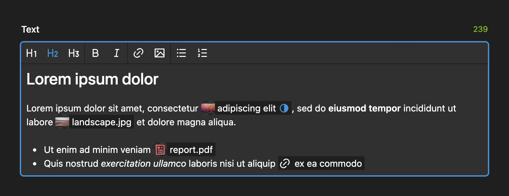

## Installation

```bash
composer require medienbaecker/kirby-tiptap
```

Requires Kirby 6+ and PHP 8.3+. For Kirby 5, use version 1 (`composer require medienbaecker/kirby-tiptap:^1`). Without Composer, copy this repository to `site/plugins/kirby-tiptap`.

## Quick start

```yml
fields:
  text:
    type: tiptap
```

```php
<?= $page->text()->kt() ?>
```

## Toolbar

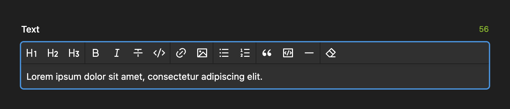

```yml
buttons:
  # Default
  - headings:
      - 1
      - 2
      - 3
  - bold
  - italic
  - link
  - file
  - bulletList
  - orderedList
  # More
  - strike
  - code
  - codeBlock
  - blockquote
  - horizontalRule
  - removeFormatting
  - taskList # format: json only
  - "|"      # divider
```

With `inline: true` the field has no paragraphs and hides the block buttons. Render it with `kti()`.

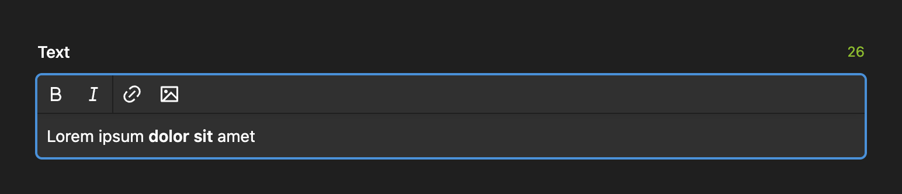

## KirbyTags as pills

Image, file, video, link, email and tel tags show as pills, like in Kirby's link field. A pill turns red when its page or file is gone. Other tags, such as `(date: year)` or tags from your own plugins, stay text.

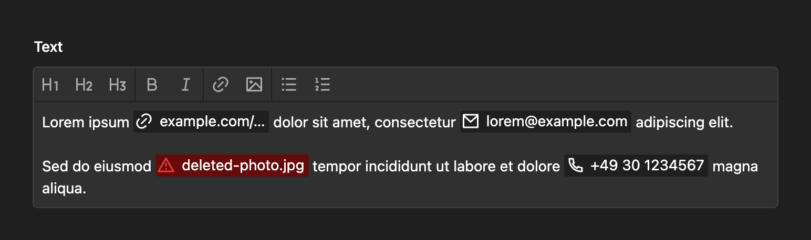

Click a pill to edit it. Drag it to move it. Right-click it to open the link, or the page or file in the Panel. With the keyboard, select it with the arrow keys and press Enter.

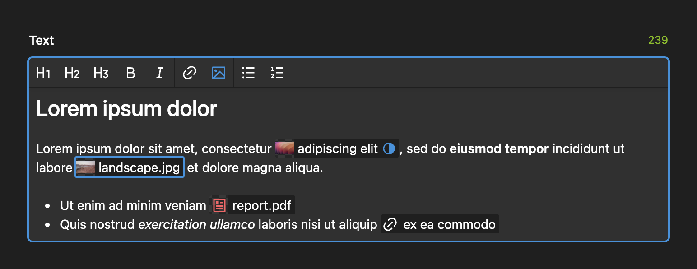

To edit the tags as text, set `kirbytags: true` on the field, or `'medienbaecker.tiptap.kirbytags' => true` in the config. Cmd+Click on a tag then opens its page or file.

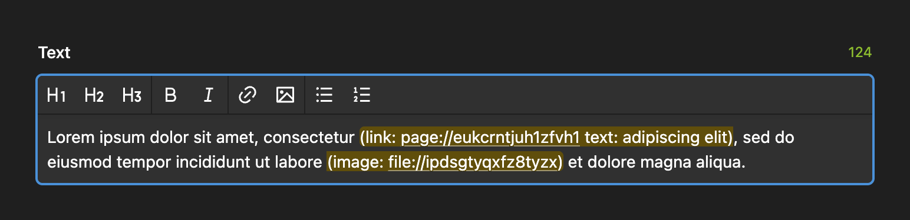

## Link and file dialogs

The link dialog picks the right tag: `link`, `email`, `file` or `tel`. The file dialog inserts `image` or `file`. Both edit the tag under the cursor.

Add your own fields to the dialogs. Their names must be attributes of the tag, such as `alt`, `caption` or `class`.

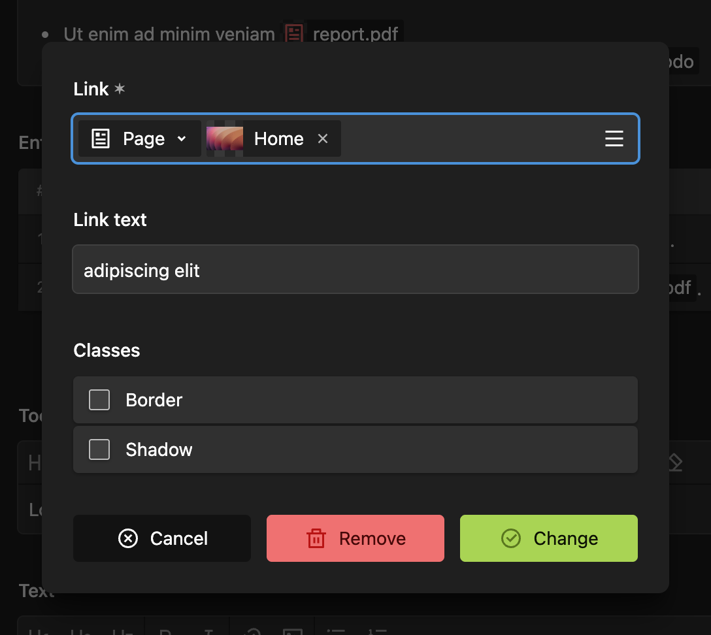 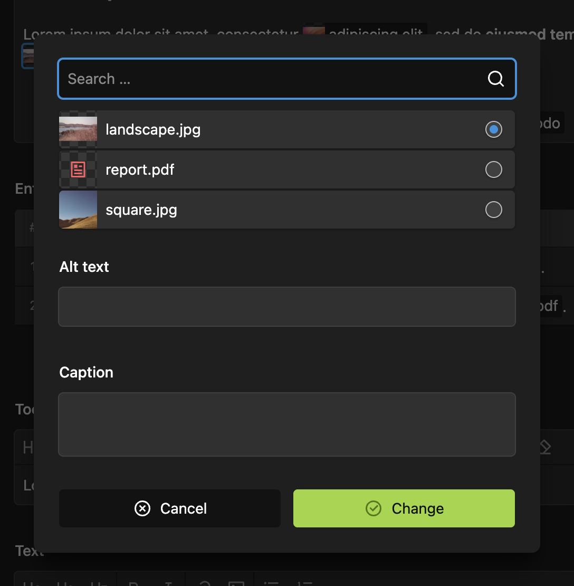

```yml
links:
  options:
    - page
    - url
  fields:
    class:
      label: Classes
      type: checkboxes
      options:
        border: Border
        shadow: Shadow
files:
  query: page.images
  fields:
    caption:
      label: Caption
      type: textarea
```

## Drag, drop and paste

Drag pages and files from the Panel into the field. Drop or paste files from your computer to upload them, several at once. Pasted HTML links become link tags.

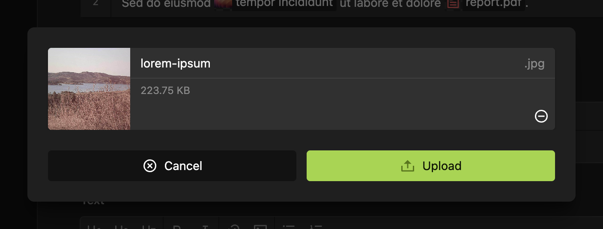

```yml
uploads:
  template: image
  parent: site
# or
uploads: false
```

## Previews and blocks

Structure and object fields preview the text with pills.

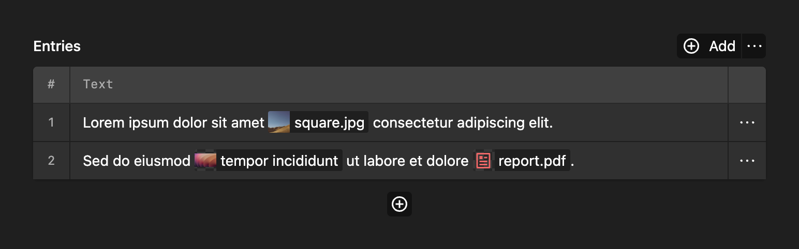

The plugin adds a `tiptap` block for the blocks field.

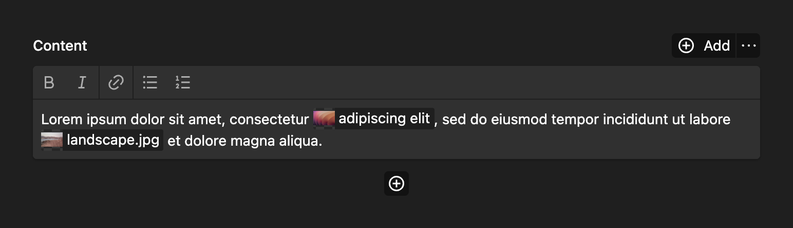

## Special characters

Type `(-)` for a soft hyphen and `(_)` for a non-breaking space. The editor shows both.

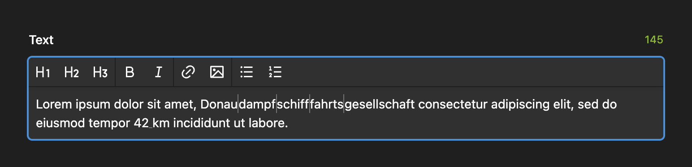

## Keyboard shortcuts

`Mod` is Cmd on Mac and Ctrl elsewhere.

| Action | Shortcut |
| --- | --- |
| Bold, italic, code | `Mod+B`, `Mod+I`, `Mod+E` |
| Strike | `Mod+Shift+S` |
| Heading 1–6 | `Mod+Alt+1` to `Mod+Alt+6` |
| Bullet list, ordered list | `Mod+Shift+8`, `Mod+Shift+7` |
| Blockquote, code block | `Mod+Shift+B`, `Mod+Alt+C` |
| Link dialog | `Mod+K` |

## JSON format

The field stores Markdown by default. When a field holds something Markdown can't express, such as a custom node or attribute, it stores that field as Tiptap JSON instead, so nothing gets lost. To always store JSON, set `format: json` on the field, or `'medienbaecker.tiptap.format' => 'json'` in the config.

Render JSON with `tiptap()`, or `tiptapInline()` for inline fields. Both also render Markdown, so use them when a field may hold either:

```php
echo $page->text()->tiptap([
  'offsetHeadings' => 1, // h1 becomes h2
  'allowHtml' => true,   // render HTML instead of escaping it
]);
```

JSON renders through snippets. To change the HTML of a node, copy its snippet from the plugin's `snippets/tiptap/` folder to `site/snippets/tiptap/`, or register it as `tiptap/heading` in your own plugin. For example `heading.php`:

```php
<?php
$id = Str::slug(strip_tags($content));

echo Html::tag('h' . ($attrs['level'] ?? 1), [$content, Html::a('#' . $id, '#')], [
  ...array_diff_key($attrs ?? [], ['level' => true]),
  'id' => $id,
]);
```

## Options

The field also takes Kirby's usual field options, such as `required`, `placeholder` and `maxlength`.

```yml
text:
  type: tiptap
  inline: true
  format: json
  kirbytags: true
  pretty: true # format: json only
```

```php
// site/config/config.php
'medienbaecker.tiptap' => [
  'format' => 'markdown',
  'kirbytags' => false,
  'uuid' => [ // UUIDs for dragged pages and files, defaults to content.uuid
    'pages' => false,
    'files' => true,
  ],
],
```

## Extensions

Plugins can add buttons, shortcuts and Tiptap extensions, and change the built-in ones. [`extension-examples/`](extension-examples) has working examples.

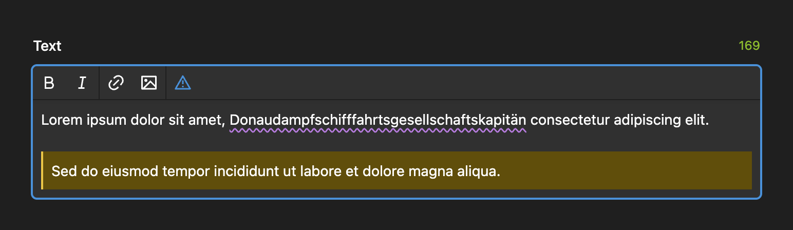

Register everything in your plugin's `index.js`:

```js
window.kirbyTiptap ??= {};
window.kirbyTiptap.registry ??= { extensions: [], buttons: [], shortcuts: [] };
```

### Buttons and shortcuts

```js
window.kirbyTiptap.registry.buttons.push({
	name: "signature",
	label: "Insert signature",
	icon: "pen",
	command: ({ editor }) => editor.chain().focus().insertContent("Lorem ipsum").run(),
});

window.kirbyTiptap.registry.shortcuts.push({
	name: "horizontalRule",
	keys: ["Mod-Shift-H"],
	command: ({ editor }) => editor.chain().focus().setHorizontalRule().run(),
});
```

Add `signature` to a field's `buttons`. Shortcuts work in every field.

### Tiptap extensions

For nodes, marks and ProseMirror plugins, push a factory. It gets the field's own Tiptap and ProseMirror, so you don't bundle a second copy:

```js
window.kirbyTiptap.registry.extensions.push({
	name: "wordCount",
	create({ tiptap, pm, field, extensions, components, kirbytags }) {
		return tiptap.core.Extension.create({ name: "wordCount" /* … */ });
	},
	buttons: () => [/* buttons that belong to the extension */],
});
```

| Argument | Contains |
| --- | --- |
| `tiptap` | `core`: `Extension`, `Node`, `Mark`, `mergeAttributes`. `vue3`: `VueNodeViewRenderer`, `NodeViewWrapper` |
| `pm` | `state`: `Plugin`, `PluginKey`, `NodeSelection`, `TextSelection`. `view`: `Decoration`, `DecorationSet` |
| `field` | The field's `endpoints`, `files`, `links` and `uploads`, undefined in previews. `files.fields` and `links.fields` are the dialog fields |
| `extensions` | The built-in extensions by name, e.g. `kirbytag`, `bold`, `paragraph` |
| `components` | `KirbytagView`, the pill. `this.tag.item` is the page or file it shows; its default slot adds to the end of the label |
| `kirbytags` | `parse(text)` reads a tag, `target(text, model)` finds its page or file |

Custom nodes need a snippet to render on the frontend, see [JSON format](#json-format).

### Changing a built-in

An extension with a built-in's name replaces it in every field that uses it. Extend the original to change one part, like how pills look:

```js
window.kirbyTiptap.registry.extensions.push({
	name: "kirbytag",
	create({ tiptap, extensions }) {
		return extensions.kirbytag.extend({
			addNodeView: () => tiptap.vue3.VueNodeViewRenderer(MyPill),
		});
	},
});
```

A pill is a `kirbytag` node with the tag in `attrs.text`. When two plugins change the same extension, the second gets the first one's version in `extensions`.

### Options per field

Set options by extension name. The extension reads them from `this.options`:

```yaml
text:
  type: tiptap
  extensions:
    wordCount:
      max: 500
```

### Commands

| Command | Does |
| --- | --- |
| `openLinkDialog()` | Edits the link tag under the cursor, or inserts one |
| `openFileDialog()` | Edits the file tag under the cursor, or inserts one |
| `editKirbytag()` | Edits the selected pill |
| `uploadFiles(files?)` | Uploads files, or opens the file picker, and inserts the tags |
